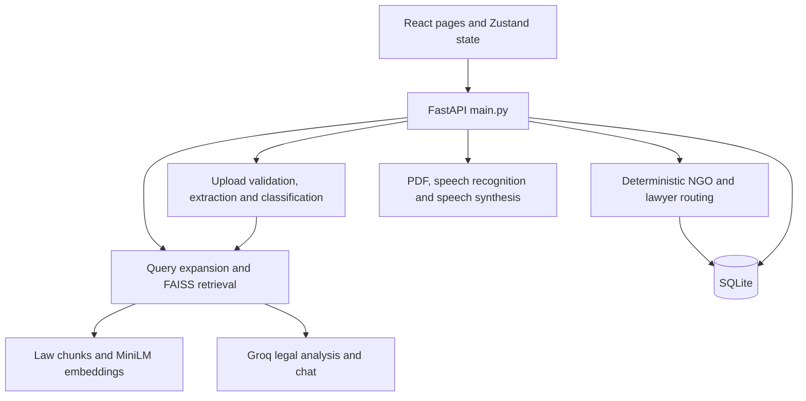

**Pakistan AI Legal Aid — project review**

This is the **baseline review before repairs**. Findings below describe the original checkout. See [VERIFICATION.md](VERIFICATION.md) for implemented fixes, test results, and deployment status.

Reviewed on 18 October 2026. Scope: the local React/FastAPI repository, its existing SQLite database and retrieval artifacts, documentation, dependencies, and launch/deployment configuration. Application source was not changed. The existing change to `frontend/vite.config.js` and existing runtime logs were preserved.

**Assessment**

This is a substantial final-year-project prototype with working frontend builds, a functioning local retrieval index, bilingual UI infrastructure, document processing, PDF generation, and deterministic case routing. Its main weaknesses are access control, the reliability of legal output, document coverage, and consistency between features. It is not ready for public use with confidential case information in its present form.

That conclusion is based on reproduced behavior, including unauthenticated access to case-management APIs, accepted invented citations in mocked model output, contradictory chat memory, incorrect risk classifications, and broken workflow operations. It is not a claim that the live deployed service was tested or that any real case record was accessed over the network.

**Project inventory and architecture**

| Area | What is present |
| --- | --- |
| Frontend | React 18, Vite 5, React Router, Zustand, Tailwind, Framer Motion, Recharts, React Hook Form/Zod |
| Frontend size | 29 source/style files, approximately 8,636 lines |
| Backend | FastAPI, Groq SDK, sentence-transformers, FAISS, SQLite, ReportLab, PDF/DOCX/image extraction |
| Backend size | 36 Python files under `backend/app`, approximately 12,755 lines, plus `main.py` and `build_index.py` |
| Corpus | 43 PDF files and 10,498 indexed chunks; existing embedding cache identifies a 384-dimensional MiniLM model |
| Database | Five application tables: query logs, feedback, applications, NGOs, lawyers |
| Local database checks | Integrity check passed; row counts were 195 query logs, 1 feedback record, 2 applications, 13 NGOs, 33 lawyers |
| Translations | 233 English keys and 233 Urdu keys in the active frontend dictionary |
| Dependency management | Tracked frontend lockfile; backend requirements use lower bounds without a lockfile |

The active backend API is implemented directly in `backend/main.py`. `backend/app/chat_api.py` is a separate older FastAPI application; it is not mounted by `main.py`. Similarly, the current `/chat` frontend route redirects to `/home`; the drawer is the active chat interface. Documentation describes some older routes and component arrangements.

**What is working well**

- The frontend production build succeeds, and page-level lazy loading is already implemented.
- Retrieval works offline with the cached model and index. English and Urdu unpaid-wage queries both retrieved labour-law passages in the smoke checks.
- Embedding normalization and FAISS inner-product search are consistent with cosine similarity. The embedding cache checks the configured model name before reuse.
- Routing is separate from the LLM, with explicit category, city, availability, and workload rules.
- SQL values generally use parameterized queries; inspected dynamic column updates use allowlists.
- Uploads use generated temporary filenames, and document uploads have a cleanup path.
- Both English and Urdu PDF generation produced valid single-page PDFs in synthetic smoke tests; an Urdu font registered successfully.
- Frontend translation dictionaries have matching keys, and static translation calls and alias imports resolved successfully.
- Analysis, chat, document analysis, and TTS already offload significant blocking work to an executor.

**Feature coverage**

| Feature | Review result |
| --- | --- |
| Legal case analysis | Implemented; output citations and confidence need server-side validation |
| Follow-up chat | Implemented; memory negation, case isolation, and session ownership need correction |
| Voice transcription | Implemented for English/Urdu through Groq; actual provider calls and microphone recording were not exercised |
| Text-to-speech | Three-provider fallback is implemented; external synthesis was not exercised |
| PDF reports | Synthetic English/Urdu generation passed; visual typography was not inspected |
| Document analysis | Implemented; only the first 3,000 characters reach the analysis model |
| Scanned documents | Image OCR is implemented; image-only PDFs do not enter the OCR path |
| NGO recommendations | Analysis uses static JSON; directory and application routing use the database |
| Lawyer directory/routing | Implemented; workload accounting and deletion integrity need correction |
| Applications/admin | Broad functionality exists; API authorization is absent |
| Analytics/feedback | Analytics works in isolation; feedback submission returns HTTP 500 |
| Deployment | Local build works; Linux corpus path, Docker contents, production serving, and configuration need attention |

**Prioritized findings**

**C01 — Critical: administrative and confidential APIs have no backend authorization. Reproduced.**

`backend/main.py:714` checks a password and returns a random token, but no backend dependency or middleware validates that token. The frontend adds `X-Admin-Token` in `frontend/src/services/api.js:11`; the backend never reads it. The client-side `adminAuthenticated` flag is also persisted in local storage and cannot act as an access-control boundary.

Using a temporary database and requests without credentials, the review received HTTP 200 when listing applications, reading an application, reading query analytics, creating an NGO, creating a lawyer, and changing case assignments. Relevant routes start at `backend/main.py:458`, `backend/main.py:555`, `backend/main.py:632`, and `backend/main.py:670`. Chat history and deletion endpoints also accept a session identifier without checking ownership (`backend/main.py:355`).

The configured CORS list contains `*` with credentials enabled (`backend/main.py:112`). A preflight from an unrelated synthetic origin was accepted. This compounds exposure in browsers; restricting CORS alone would not authorize API access.

Implement a real server-validated session with expiration and logout/revocation, protect every administrative read/write route, and bind chat sessions to their owners. Require an explicitly configured admin credential instead of falling back to `admin123`. Add regression checks that anonymous requests receive 401/403.

**H01 — High: privacy claims contradict actual storage and exposure. Confirmed in source.**

The sidebar says “No data stored” (`frontend/src/components/layout/AppLayout.jsx:107`). In fact, successful analysis writes the raw query and part of the summary to SQLite (`backend/main.py:267`, `backend/app/utils/db.py:221`), and applications persist names, contact details, and case descriptions. Calling query logs “anonymous” does not remove identifying information that a person types into a query.

The application form also promises consent-based sharing (`frontend/src/services/i18n.js:126`), but there is no recorded consent field or sharing authorization workflow. The Urdu translation at line 404 uses wording that contradicts the English consent statement. PDF exports remain in the operating-system temporary directory, and TTS caches have no eviction policy.

Align the UI with actual behavior, explicitly describe external AI/speech processing, minimize stored case text, define retention/deletion behavior, and record consent if consent is part of the promised workflow. Fix access control before accepting sensitive submissions.

**H02 — High: risk classification can produce misleading urgency. Reproduced.**

`stabilize_risk()` uses substring matching and broad informational-query rules (`backend/app/utils/groq_client.py:137`). Synthetic examples returned:

| Input | Observed result |
| --- | --- |
| “I need help with a skill training employment contract.” | Critical, because `skill` contains `kill` |
| “What is the law about murder in Pakistan?” | Critical, despite being an informational question |
| “How do I report harassment by my employer?” with an incoming High model rating | Low, because the informational rule overrides it |

The document page independently derives severity from English words (`frontend/src/pages/DocumentAnalysisPage.jsx:45`). An English arrest warning was classified as critical, while an Urdu arrest-risk statement fell through to low.

Return a structured, language-independent risk enum with supporting reasons. Use token/phrase boundaries, distinguish current danger from informational mentions, and avoid silently lowering a serious report based only on its question prefix. Test paired English/Urdu cases and negation.

**H03 — High: document analysis omits most of a longer document. Reproduced.**

`backend/app/utils/groq_client.py:1286` limits retrieval to the first 800 characters and model analysis to the first 3,000. The separate 50,000-character sanitization cap does not mean the model reviews 50,000 characters. A synthetic deadline after character 3,100 was absent from the prompt.

The prompt includes a truncation note, but the API response has no dedicated coverage field and the UI presents the result as the document's analysis. Clauses and deadlines near the end of a contract can therefore be omitted from the actual analysis.

Analyze document sections in bounded chunks, combine findings with page/paragraph references, and return explicit coverage/truncation metadata. Until full coverage is implemented, display the reviewed range prominently and avoid implying that absent findings apply to the whole document.

**H04 — High: grounding instructions are not enforced on model output. Reproduced with mocks.**

`analyze_with_rag()` parses JSON and normalizes a few enum values, then accepts the returned laws, rights, steps, and confidence (`backend/app/utils/groq_client.py:980`). There is no check that a cited law/section appears in the provided chunks. With mocked model output, an invented `UNRETRIEVED AUDIT ACT` citation was accepted with High confidence even though the only source was a different synthetic act.

The main analysis path also calls the model when retrieval is empty. A mocked response with invented laws and High confidence was accepted in that situation. Chat has a stronger pre-generation empty-context gate, but its generated citations are still not validated after generation. Document analysis similarly trusts returned `cited_laws`.

These tests establish missing enforcement, not the frequency of hallucinations from the real provider. Require structured citations referencing allowed chunk IDs; reject unsupported law/section references; enforce empty-source behavior in code; and validate output with strict schemas. Treat confidence as a heuristic until calibrated against a reviewed evaluation set. A substring injection blocklist is not a reliable grounding control.

**H05 — High: chat memory invents affirmative facts from negated statements. Reproduced.**

The regex extractor at `backend/app/utils/chat_service.py:551` labels mentions as facts without considering negation. “I have no written contract and no witnesses” produced both “User has a written contract/agreement” and “User does not have a written contract,” as well as “User has witnesses.” “I do not have salary slips or WhatsApp messages” produced affirmative evidence claims.

These labels persist in `case_facts` and are inserted into later prompts. Track assertions with their original text and polarity, distinguish questions from facts, and allow later corrections to replace earlier assertions.

**H06 — High: public expensive endpoints have weak resource controls. Source review; no load test performed.**

AI, OCR, speech, and PDF endpoints have no application-level rate limit or concurrency budget. Document and audio uploads read the entire file before checking their configured byte limits (`backend/app/utils/document_loader.py:136`, `backend/main.py:375`). PDF page counts and decompressed DOCX/image sizes have no explicit processing budget.

The document timeout limits how long the coroutine waits, but it does not stop an already-running executor thread. OCR calls themselves have no timeout argument (`backend/app/utils/text_extractor.py:453`). Cleanup can therefore run while extraction is still working, and timed-out work can continue consuming resources. Python documents that an executing future cannot be cancelled: [Python future cancellation](https://docs.python.org/3.11/library/concurrent.futures.html#concurrent.futures.Future.cancel).

Add request/body limits at the deployment boundary, bounded reads, per-client quotas, bounded job concurrency, page/pixel/archive limits, provider timeouts, and an execution strategy that can terminate long OCR work safely.

**H07 — High: Docker builds can include local case data and hide index failures. Confirmed in source; image not built.**

`backend/Dockerfile:19` copies the backend directory into the image, while `.dockerignore` does not exclude the local database, logs, virtual environment, or other generated artifacts. A build from this checkout would include the local SQLite database in the image context and copied application files.

The configuration points to `data/laws`, while the tracked directory is `data/Laws` (`backend/app/utils/config.py:21`). This works on the current Windows filesystem but fails on a case-sensitive Linux filesystem. The Docker build runs `python build_index.py || true`, which suppresses that failure. A preexisting index copied from the checkout can conceal the issue until a clean build.

Use the exact corpus directory name, exclude private/runtime files from image builds, build the index reproducibly or provision it as a versioned artifact, and fail the image build when required assets cannot be prepared. Put runtime database data on an explicitly managed persistent volume.

**H08 — High: source provenance and corpus/category boundaries are incomplete. Confirmed in artifacts and smoke checks.**

All 10,498 chunk records have `page_start: 1`, because ingestion hardcodes it (`backend/app/utils/ingest.py:221`). The metadata has no structured jurisdiction, effective-date, amendment-version, or authoritative-source URL fields. The API further reduces sources to names, sections, snippets, and scores, making independent verification harder.

The active taxonomy includes Inheritance Law and Consumer Rights, but no indexed chunks carry those category labels. This does not mean inheritance content is absent: the Succession Act is indexed as Civil Law. More broadly, the corpus has 981 `Civil Law` chunks and 407 `Core` chunks outside the current canonical case-type list. Document category allowlists use `Procedural Law`, while the corpus uses `Civil Law / Procedure` (`backend/app/utils/groq_client.py:1320`).

The consumer-refund smoke query retrieved criminal/civil-procedure and succession passages; the inheritance query ranked a Divorce Act passage before succession passages. These are retrieval-quality signals requiring a reviewed benchmark, not legal conclusions about the statutes.

Preserve true page offsets and authoritative provenance, map corpus categories consistently, and filter by applicable jurisdiction/version before generating an answer. Have a qualified reviewer assess corpus coverage and answer correctness. This review did not verify whether each law or contact record is current.

**M01 — Medium: workload accounting and case transitions drift. Reproduced.**

Assigning the same lawyer twice changed `active_cases` from 1 to 2 to 3 for one case (`backend/app/utils/application_service.py:323`). Resolving that case left the count at 3. Reassignments increment the new lawyer without decrementing the old lawyer, and status updates never use the existing decrement helper. Rerouting the resolved case changed it back to assigned (`backend/app/utils/application_service.py:508`).

Update assignments, status, and workload in one transaction. Make repeated assignments idempotent, release workload on completion/reassignment, and explicitly govern whether rerouting can reopen a completed case. Add a reconciliation query comparing counters with active assignments.

**M02 — Medium: chat context can cross case boundaries and is local to one process. Confirmed in source.**

Analyzing or clearing a case does not reset the shared chat session (`frontend/src/pages/HomePage.jsx:52`). The drawer sends an empty `last_query` (`frontend/src/components/chat/AIAssistantDrawer.jsx:116`), while backend retrieval incorporates the previous user turn. Earlier case facts can therefore carry into a new case.

Sessions also live in a process-local dictionary (`backend/app/utils/chat_service.py:106`). The documented two-worker deployment gives each worker a different history. Individual operations are locked, but an entire chat turn is not serialized per session, so simultaneous requests can interleave.

Bind analysis and conversation to an explicit case ID, keep the original query, reset or switch context on case changes, serialize turns per session, and use shared session storage before using multiple workers. TTL enforcement should cover reads as well as new chat activity.

**M03 — Medium: supported-document behavior differs between UI and backend. Reproduced.**

The document page accepts TXT files (`frontend/src/pages/DocumentAnalysisPage.jsx:508`); the backend rejects `text/plain`/`.txt` uploads. A synthetic TXT upload was rejected with the unsupported-file-type error.

For an image-only PDF, `extract_pdf()` returned zero characters and a warning instead of running OCR (`backend/app/utils/text_extractor.py:287`). Installing Tesseract alone does not enable OCR for scanned PDFs. OCR is currently applied to individual image uploads.

Share the supported-file contract between client and server. Implement bounded page rendering plus OCR for scanned PDFs, or describe that limitation accurately in the interface and documentation.

**M04 — Medium: several API contracts are broken or incomplete. Reproduced/source review.**

- Feedback always fails for otherwise valid input: `backend/main.py:704` passes `session_id` to `save_feedback()`, whose signature has no such argument (`backend/app/utils/db.py:254`). The isolated request returned HTTP 500.
- The applications endpoint accepts `city` but never applies it (`backend/main.py:459`). A Lahore filter returned the synthetic Karachi case.
- Invalid status input raises an uncaught service `ValueError` and returns 500 instead of a validation response.
- CNIC is accepted by the form/request model and forwarded into an intermediate dictionary, then omitted from persistence. Remove unnecessary collection or implement the intended handling explicitly.
- `LawyerCreateRequest` omits `expertise_sub`; a submitted specialization was silently discarded in the API check.
- Several request models have no useful field limits or language/status enums; feedback ratings are not constrained to 1–5.

Define explicit request/response schemas, reject unsupported fields where appropriate, generate frontend types from OpenAPI, and add contract checks for each supported field.

**M05 — Medium: startup and hosting configuration are inconsistent. Confirmed in source and API smoke checks.**

The existing local Vite change targets port 8001, while `main.py` and launchers start port 8000. This may be intentional for the user's current setup; it was preserved. The default documented launch path and current proxy do not agree.

`App.jsx:43` waits for `/api/config` before rendering any route. With the shared 60-second Axios timeout, a stalled backend can delay the landing and emergency pages as well as API-dependent tools.

The README claims FastAPI serves `frontend/dist`, but there is no static mount or SPA fallback in the backend. `/` and `/home` returned 404 in the isolated app. A separate static host can serve the frontend, but that deployment needs its own API-origin and route-rewrite setup. The documented `/api/apply` and `/api/export-pdf` routes also returned 404; the implemented routes are `/api/applications` and `/api/pdf`.

Make ports/origins explicit configuration, render local pages while config loads in the background, and document one supported production topology with SPA fallback and API routing.

**M06 — Medium: mixed import namespaces duplicate cached services. Reproduced with a fake model.**

`main.py:65` imports `app.utils.embeddings`, while `rag_engine.py:21` imports `utils.embeddings`. Python loads the same source file as two modules under these names. A test replacing the actual model constructor with a fake confirmed two separate model constructions after calling both cached loaders.

This means the startup warmup can warm one embedding module while retrieval uses another, adding memory and first-request cost. RAG modules are likewise imported under both namespaces. Use one package namespace throughout and remove `sys.path` manipulation. Consolidate legacy Streamlit pages, deprecated adapters, duplicate chat components, and unused locale copies after mapping their consumers.

**M07 — Medium: database integrity and query scalability need strengthening. Confirmed in source/schema.**

There are no foreign-key definitions linking applications/lawyers/NGOs. Permanent registry deletion can leave stored assignment references dangling (`backend/app/utils/lawyer_service.py:198`, `backend/app/utils/ngo_service.py:229`). Assignment updates and workload changes use separate transactions.

Application pagination and analytics limits are applied after fetching all matching rows. The log schema does not store a city, so city analytics cannot be populated by the current logger. SQLite connections have no explicit WAL setup; several context-manager usages commit/rollback without explicitly closing the connection.

Use deliberate migrations, appropriate foreign keys or soft deletion, atomic workflow updates, deterministic connection closure, database-side pagination/aggregation, and measured concurrency settings. SQLite can remain appropriate for the intended single-server scale; replacing it is not a prerequisite for these fixes.

**M08 — Medium: frontend error and accessibility handling is incomplete. Source review; browser testing still required.**

HomePage allows queries over 2,000 characters to be submitted, then places FastAPI's `detail` directly into React output (`frontend/src/pages/HomePage.jsx:64`, line 265). Pydantic validation errors are arrays of objects, which cannot be rendered directly as children. ApplyPage already has safer error normalization that could be shared.

Some API failures are swallowed and displayed as empty lists or no response. The chat drawer and custom modals lack dialog semantics/focus trapping, icon-only controls often lack accessible names, and labels are frequently not associated with inputs. The document drop area is clickable without equivalent keyboard semantics.

Use one error-normalization utility, visible retry states, route-level error boundaries, accessible dialog primitives, explicit control labels, and keyboard/screen-reader checks. Microphone recording also needs cleanup when leaving HomePage; its unmount cleanup currently handles only playback audio.

**M09 — Medium: successful translation-key checks do not establish full Urdu parity. Confirmed in source and one pure-function check.**

Both dictionaries contain the same 233 keys, but navigation section labels, risk badges, confidence labels, document expand/collapse text, form validation messages, and much of administration are hardcoded in English. `index.html` keeps `lang="en"`; language changes do not update the document language. The risk-severity issue in H02 is a behavioral difference, beyond text translation.

MiniLM is tagged English in its [official model card](https://huggingface.co/sentence-transformers/all-MiniLM-L6-v2), which also documents a 256-word-piece input limit. Local loading confirmed a 256-token limit. Keyword expansion helped the tested Urdu salary query, but it is not a general multilingual retrieval solution, and long Urdu inputs can consume the token budget before appended English terms are reached.

Evaluate bilingual retrieval with paired questions and human relevance judgments. Compare a multilingual embedding candidate using a rebuilt/versioned index before selecting a replacement. Localize visible UI and validation text, update document language, and test complete English/Urdu workflows.

**M10 — Medium: quality gates and dependency reproducibility are incomplete. Reproduced/source review.**

`npm run lint` fails because there is no ESLint configuration. No automated frontend/backend regression suite or CI workflow was found. `build_index.py` has printed retrieval smoke checks, but these do not fail a build on incorrect results.

Python requirements use broad lower bounds; an installation can change materially over time. The frontend lockfile is present, but launchers use `npm install` rather than a reproducible CI install. The npm advisory scan could not reach the registry endpoint, so this review makes no dependency-vulnerability clearance claim. `pip check` found no installed dependency conflicts; that is not a vulnerability scan.

Restore linting, lock a supported backend environment, define runtime versions, and run meaningful regression checks in CI. Prioritize authorization, citation enforcement, risk/negation, document coverage, workflow accounting, and upload validation over snapshot-heavy UI tests.

**Lower-priority maintenance observations**

- `AdminPage.jsx` is 2,175 lines, `groq_client.py` 1,785, and `chat_service.py` 1,374. Separate route handlers, structured schemas, prompt resources, and feature components along actual responsibility boundaries.
- `.gitignore` contains embedded null bytes near its final report-name entries. Normalize its encoding and add suitable runtime-log exclusions.
- Public/admin NGO data is inconsistent: analysis recommendations use JSON, while the public directory and case assignment use the admin database. The code itself describes database entries as test data in the analysis route comment. Define one verified public registry or make separate demonstration data explicit. Inactive NGOs are returned by the public listing's default query.
- Audio is recorded as WebM in the browser but relabeled as WAV for upload/provider handling. Actual cross-browser/provider acceptance needs testing; no codec failure is claimed from source inspection alone.
- TTS always returns `audio/mpeg` even when the offline backend creates WAV. Determine the media type from the produced file and define cache cleanup/retention.
- The optional backup-key rotation moves forward through keys without a cooldown/recovery schedule. Treat this as a fallback implementation, not request-capacity management.
- No standalone license file was found; the README's educational-purpose statement does not provide a clear reusable-source license.

**Verification performed**

| Check | Outcome and limit |
| --- | --- |
| `npm run build` | Passed; 3,190 modules transformed |
| Frontend bundle review | Main chunk ~412 KB, admin chunk ~458 KB, file-parser chunk ~954 KB, PDF worker ~1.23 MB; parser remains lazy-loaded |
| `npm run lint` | Failed: ESLint configuration missing |
| Python AST parsing | All 38 project Python files passed syntax parsing |
| Frontend parsing/import checks | All 28 JS/JSX files parsed; checked static alias imports resolved |
| Translation checks | 233 keys per language, no missing paired keys or unresolved literal `t()` keys |
| `pip check` | Passed: no broken installed requirements |
| SQLite read-only check | Integrity passed; inspected schema and counts without exporting case contents |
| Isolated API checks | 20 recorded checks against a temporary database reproduced the access-control and workflow/contract issues above |
| Mocked model checks | Unsupported citation accepted; zero-source analysis still called generation and trusted High confidence |
| Pure-function checks | Reproduced three risk cases, contradictory/negated memory, omitted late document content, and English/Urdu severity mismatch |
| Offline retrieval | Eight synthetic queries exercised the actual cached model and FAISS index; no external model call required |
| PDF checks | English and Urdu synthetic reports were generated and parsed as PDFs |
| Upload/extraction checks | TXT rejection and absent OCR for an image-only PDF were reproduced |
| Import-cache check | A fake constructor confirmed duplicate embedding instances under the two import namespaces |
| npm vulnerability audit | Incomplete: registry advisory endpoint was unreachable in this environment |

The eight retrieval cases covered English wages, Urdu wages, child custody/divorce, tenant deposit, cyber impersonation, inheritance, consumer refund, and an unrelated cooking query. The unrelated query returned no chunks. Wages, property, and cyber examples retrieved their expected broad domains; inheritance/category consistency and consumer coverage need work. These checks are a small diagnostic sample, not a measured accuracy score or a legal evaluation.

No paid Groq/ElevenLabs calls, production-site changes, real application submissions, destructive database operations, full browser interaction tests, Docker builds, or sustained load tests were performed. Live provider quality, actual speech recognition, visual Urdu PDF rendering, deployed access controls outside this repository, statutory currency, and contact accuracy remain unverified.

**Recommended implementation order**

1. **Protect case data:** enforce server-side authorization and session ownership, correct privacy statements, restrict browser origins, and stop carrying local database/log files into images.
2. **Correct analysis semantics:** repair risk/negation behavior, require validated citations and output schemas, and disclose document coverage until full-section analysis exists.
3. **Make case handling consistent:** use atomic, idempotent assignment/status updates; isolate chat by case; fix feedback, filters, file support, and request-field handling.
4. **Make builds/deployment repeatable:** fix corpus path case, unify imports, validate index artifacts, document static hosting/API routing, pin dependencies, and configure persistent storage and resource limits.
5. **Establish release checks:** add targeted API/workflow regressions, a reviewed bilingual retrieval/answer benchmark, representative document fixtures, browser accessibility checks, and CI with a working linter and build.

The current architecture can support these changes incrementally. A rewrite or a move to microservices is not necessary to address the observed defects.
